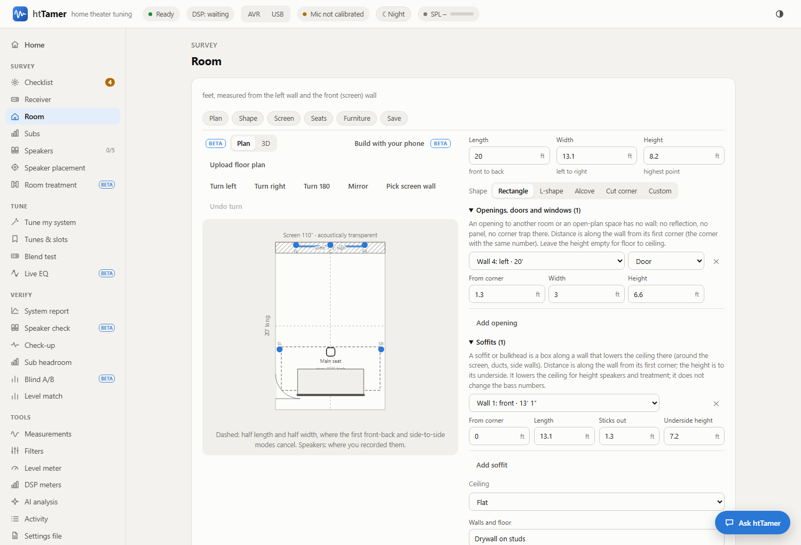
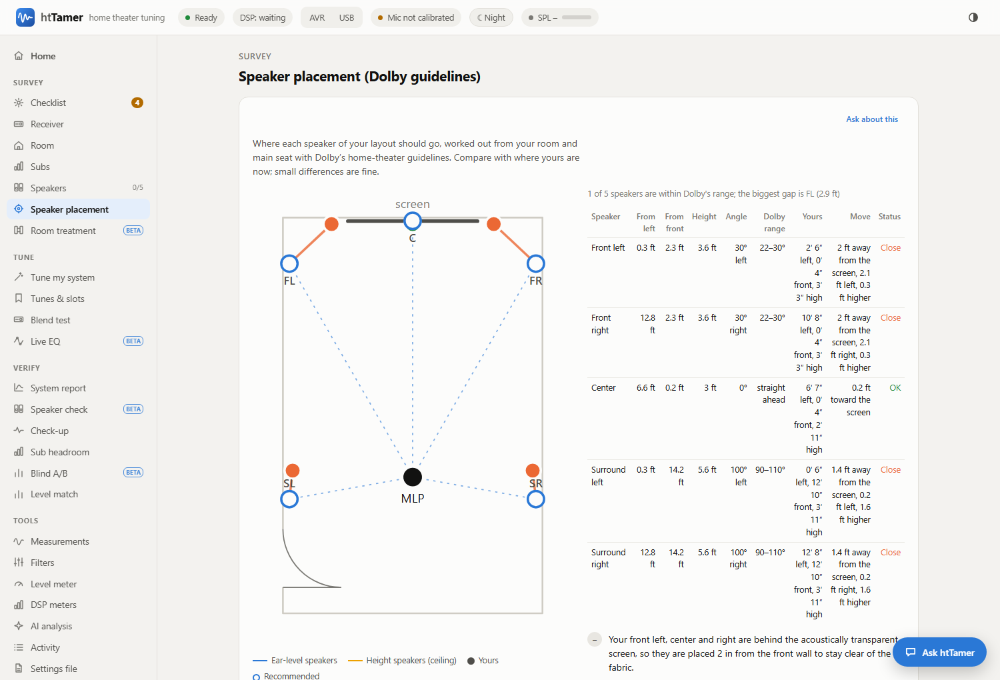

# htTamer

htTamer tunes the subwoofers of a home theater. It measures each sub with a UMIK-1
mic, writes gain, delay, polarity and EQ into a miniDSP 2x4HD, blends the subs with
the speakers through the receiver, and offers a live EQ with a live analyzer and an
assistant. It runs on a Raspberry Pi (or Windows) and is used from a web page.

> **Use at your own risk.** htTamer plays loud test sound, changes your receiver's volume and input, and
> writes settings to your miniDSP. Loud bass can damage speakers, amplifiers and hearing. htTamer is provided
> "as is", without warranty of any kind (see [LICENSE.md](LICENSE.md)); the htTamer authors are not liable for
> any damage or loss. It asks you to accept this the first time it opens. Not affiliated with or endorsed by
> Onkyo, Denon, Marantz, JBL, miniDSP, Dirac or any other maker it works with.

## Download

Get the latest build from **[Releases](https://github.com/CDand444/htTamer/releases/latest)**. Installed copies update themselves from there (Tools → Updates), with nothing to set up:

- **Raspberry Pi, ready-made SD card image (recommended)**: `httamer-<version>.img.xz`. Write it to an SD card
  with Raspberry Pi Imager (it can add Wi-Fi and SSH), plug in the miniDSP and the UMIK-1, then open
  `http://httamer.local:8765`. This is the main, tested way to run htTamer.
  See [docs/RASPBERRY_PI.md](docs/RASPBERRY_PI.md).
- **Windows 10/11 (64-bit)**: `htTamer-<version>-windows-setup.exe`. Installs for your user only
  (no admin rights), with Start-menu and desktop shortcuts. Start htTamer and the dashboard opens
  in your browser; keep its window open while you use it. Settings and measurements live in
  `%LOCALAPPDATA%\htTamer` (keys and PIN in its own `config` folder, never shared with a
  developer copy) and survive updates. The miniDSP is reached over USB with no driver. To open it
  from a phone too, choose network mode, a name and a port on the installer's Network page (or later in
  Tools → Network name); it then asks for a PIN, like the Pi.

### Already have a Pi or a Linux box running?

The image is the recommended way. If you don't want to wipe a card that already runs something else, the same
install script the image is built with also sets htTamer up on an existing system: Raspberry Pi OS (64-bit),
Debian 12+ or Ubuntu 22.04+. It is for people comfortable with a terminal, and is tested far less than the image.

```
git clone https://github.com/CDand444/htTamer.git
cd htTamer
sudo ./deploy/linux/install.sh
```

It installs htTamer in `/opt/httamer` with its own service account and a service that starts at boot, keeps its
data in `/var/lib/httamer`, and prints the address to open. It does not rename your computer (`--hostname NAME`
does) and leaves your other software alone, except that it switches off minidsp-rs's own background service if
you have one, because only one program can hold the miniDSP. Updates then come from the app (Tools → Updates),
like on the image.

Releases are built by `.github/workflows/release.yml` when a `v*` tag is pushed (the Windows
installer); the Pi image is built with `deploy/pi-gen/build-image.sh` and uploaded to the same release.

## Getting started

1. **Open the dashboard** (`http://httamer.local:8765` on the Pi, or the window the Windows installer opens) and accept the
   safety notice. Choose a PIN if it asks.
2. **Receiver**: enter its address (htTamer can search the network) so it can be put back exactly as it was after every test.
3. **Room**: describe the room (size, shape, doors and windows), the **Screen** (a TV or a projector screen, acoustically
   transparent or not), your seats, any couch or riser, and soffits. The plan and the 3D view draw it as you type; **Pick screen
   wall** turns the room so the screen is at the front.

   

4. **Subs** and **Speakers**: record each sub and speaker (model, where it stands, the receiver's own level and distance if you can
   read them off its menu). The more it knows, the sharper its advice.
5. **Speaker placement**: Dolby-guideline positions for your layout, next to where yours really are, with plain "move it this far"
   words.

   

6. **Tune my system** guides the rest: a silent hardware check, then measurements with the UMIK-1 (the only steps that play sound,
   and only when you start them), writing the tune to the miniDSP, and **Verify**. After the all-speakers check, the
   **receiver setup sheet** lists what to change in the receiver, channel by channel.
7. **Tools → Backups** keeps your room, tunes and settings safe: weekly, before each update and on demand, with one-click restore.

The built-in assistant (the chat button) can read all of this and, with your approval for anything that plays sound or changes
your hardware, help with each step. Everything is also in the [user manual](subtune/web/manual.html).

## Turning on the AI (optional)

The assistant, the room analysis, AI treatment plans and the phone room builder need an AI provider; everything else works
without one. Set it up in **Tools → AI analysis** (or the AI step of the first-start setup), either way:

**Your own API key** (billed by the provider per use; htTamer caps requests at 300 a day by default)
1. Make a key: [Anthropic](https://console.anthropic.com) → API keys (best tested), [OpenAI](https://platform.openai.com) →
   API keys, or [Google Gemini](https://aistudio.google.com) → Get API key.
2. Choose that **AI provider**, paste the key, press **Save**.
3. Press **Load list**, pick a **Model**, press **Test**.

The key stays on the device running htTamer and is only sent to that provider.

**A local model** (free, on your own computer; on a Pi, run it on another computer on your network)
1. Install [Ollama](https://ollama.com) and pull a model (`ollama pull qwen3`), or [LM Studio](https://lmstudio.ai) with a
   model and its server started.
2. If htTamer runs on another computer: Ollama needs `OLLAMA_HOST=0.0.0.0` (then restart it); LM Studio needs
   **Serve on Local Network**. Allow it through that computer's firewall on private networks if asked.
3. Choose **Local model (Ollama, LM Studio…)** and enter the **Local server address**:
   `http://<that computer's address>:11434/v1` (Ollama) or `:1234/v1` (LM Studio). No key needed.
4. Press **Save**, **Load list**, pick the model, press **Test**.

Local models are slower and weaker with the assistant's tools; use the largest one your graphics card holds. The
safety rules are the same either way: anything that plays sound or changes something still asks you first.

## Documentation

- User manual: `subtune/web/manual.html` (in the app under System → Manual, or at `/manual`)
- Raspberry Pi install: [docs/RASPBERRY_PI.md](docs/RASPBERRY_PI.md)
- Receiver setup: [docs/RECEIVER_SETUP.md](docs/RECEIVER_SETUP.md)
- Changes: [docs/CHANGELOG.md](docs/CHANGELOG.md)

The Python package is named `subtune`; everything else (paths, service, host, files) is named `httamer`.

## Using htTamer from an AI client (MCP)

htTamer has an MCP server, so an AI client such as Claude Desktop or Claude Code can read its
state and run its actions with the same tools as the in-app assistant. Turn it on under
**Tools → MCP** (off by default); that page shows the config to copy. Two transports:

- **stdio**: `python -m subtune mcp` (the installed Windows app: `htTamer.exe mcp`; a Pi: the same
  command over `ssh`). It forwards each request to the running dashboard.
- **Streamable HTTP**: `http://<host>:8765/mcp` with `Authorization: Bearer <token>`.

Every `/mcp` request needs a credential, even from the same computer: the MCP token (made on
that page, shown once, stored only as a hash, revocable), a signed-in dashboard session, or the
local key in htTamer's config folder that `subtune mcp` uses when run as the same user. Over ssh
to a Pi, `subtune mcp` reads the token from `$HTTAMER_MCP_TOKEN` or `~/.httamer-mcp-token`.

Tools that play sound or write the miniDSP or receiver are refused unless the owner allows
actions on that page: either htTamer asks the owner each time (MCP elicitation, through the stdio
command) or it relies on the client's own approval prompt. Slot 1 is never written, receiver volume
can only be lowered, and keys and tokens are scrubbed from results.

## Tests

Offline tests need no hardware and play no sound:

```
python tests/test_liveeq.py      # each tests/test_*.py file runs on its own
```

On the Pi, `subtune smoke` checks the hardware silently (miniDSP, receiver, mic,
HDMI); see the manual.

## License

htTamer is **source-available for non-commercial use** under the
[PolyForm Noncommercial License 1.0.0](LICENSE.md). You may use, change and share it
for any non-commercial purpose (personal use, study, hobby projects, charities,
schools and the like). Commercial use needs separate permission from the copyright
holder.

This is not an OSI "open source" license, because those allow commercial use.

Third-party components keep their own licenses. They are installed separately, not
included in this repository: numpy and scipy (BSD), sounddevice (MIT), the anthropic
SDK (MIT) and minidsp-rs (fetched by the setup scripts; see its project for its license).
